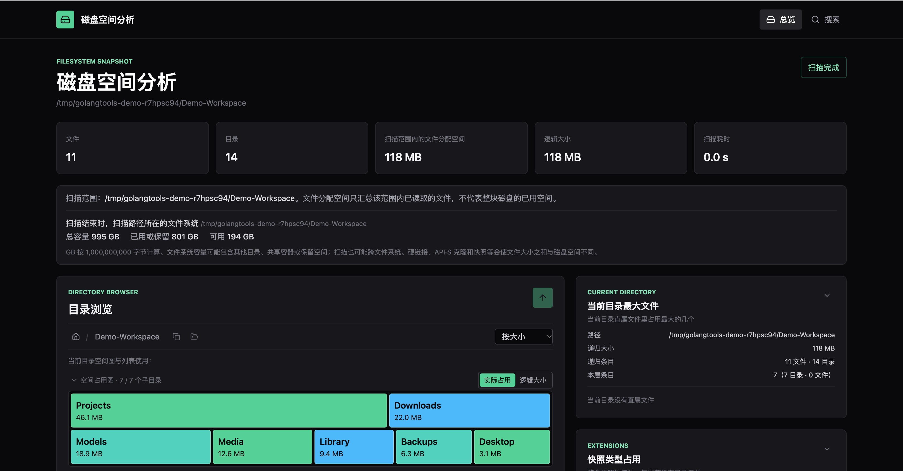
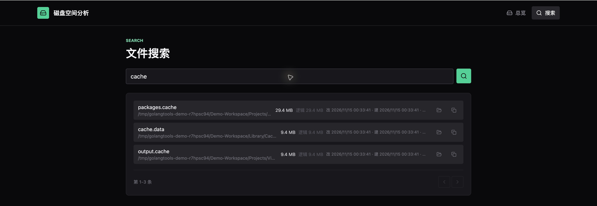
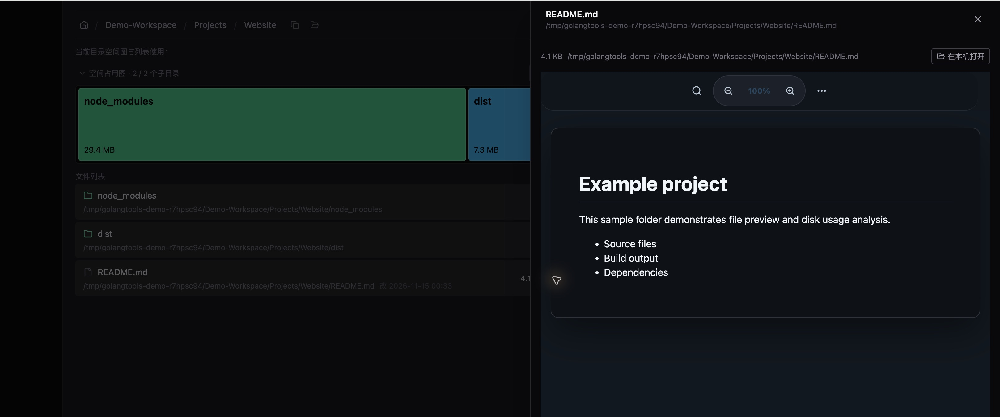

# golangtools

`golangtools` 是一个模块化的跨平台系统工具集。文件系统模块使用原生目录读取、单文件 GTI 快照和本地只读 Web 服务，可以处理百万级目录树，而不生成巨型 CSV 或单文件 HTML。

[下载最新版本](https://github.com/NOBB2333/liunx_go_tools/releases/latest) · [文件系统使用指南](docs/filesystem-user-guide.md) · [AI 查询指南](docs/ai-disk-analysis.md)

## 功能一览

- **磁盘空间分析**：扫描目录树，按实际分配空间或逻辑大小查看目录、文件和扩展名排行；读取失败的路径会单独列出。
- **可交互的本地浏览器**：通过空间占用图、目录列表和文件名搜索定位内容，支持复制路径、在文件管理器中打开和常见格式预览。
- **AI 与脚本查询**：`filesystem inspect` 直接读取快照并输出分页 JSON，按名称、目录或大小检索，不需要启动网页。
- **单文件离线快照**：扫描结果保存在 `snapshot.gti`；可以复制到其他机器浏览，不包含原始文件内容。
- **其他系统工具**：提供归档、文档提取、进程监控、网络扫描、清理分析、Mock 数据和健康检查等命令。

## 界面截图

以下截图来自真实界面，文件名和目录均使用单独生成的演示数据。

**空间总览与目录占用**



**文件名搜索**



**文件预览**



## 下载与快速开始

从 [GitHub Releases](https://github.com/NOBB2333/liunx_go_tools/releases/latest) 下载对应系统和架构的压缩包。macOS 与 Linux 使用 `.tar.gz`，Windows 使用 `.zip`；下载页同时提供 `SHA256SUMS`。

| 电脑 | 压缩包名称中的平台标识 |
| --- | --- |
| Apple 芯片 Mac | `darwin-arm64` |
| Intel 芯片 Mac | `darwin-amd64` |
| Linux x86-64 / ARM64 | `linux-amd64` / `linux-arm64` |
| Windows x86-64 / ARM64 | `windows-amd64` / `windows-arm64` |

解压后，在压缩包目录运行以下命令。示例使用 Apple 芯片 Mac，其他系统请将 `BIN` 换成对应的可执行文件；扫描输出应放在被扫描目录之外。

```bash
BIN=./golangtools-darwin-arm64
SNAPSHOT="$(mktemp -d "${TMPDIR:-/tmp}/golangtools-snapshot.XXXXXXXX")"

"$BIN" filesystem scan -root "$HOME" -output "$SNAPSHOT" -metadata basic
"$BIN" filesystem serve -snapshot "$SNAPSHOT/snapshot.gti" -listen 127.0.0.1:8080
```

浏览器访问 `http://127.0.0.1:8080/`。需要给 AI 或脚本分析时，可直接查询同一份快照：

```bash
"$BIN" filesystem inspect -snapshot "$SNAPSHOT/snapshot.gti"
"$BIN" filesystem inspect -snapshot "$SNAPSHOT/snapshot.gti" \
  -view largest -kind directories -query node_modules
```

Windows PowerShell 示例（将 `D:\Data` 改成要扫描的目录）：

```powershell
$BIN = ".\golangtools-windows-amd64.exe"
$SNAPSHOT = Join-Path $env:TEMP ("golangtools-snapshot-" + [guid]::NewGuid())
& $BIN filesystem scan -root "D:\Data" -output $SNAPSHOT -metadata basic
& $BIN filesystem serve -snapshot (Join-Path $SNAPSHOT "snapshot.gti") -listen 127.0.0.1:8080
```

快照反映扫描时刻；扫描路径可能只是整个磁盘的一部分。缓存、硬链接、APFS 克隆和虚拟磁盘等情况会影响实际可释放空间，清理前应检查用途。更多使用方法见 [文件系统使用指南](docs/filesystem-user-guide.md)。

## 直接构建

需要 Go 1.24+、pnpm 12+ 和 Node.js 20+。macOS/Linux 使用 `build.sh`；Windows 使用 `build.ps1` 或双击 `build.cmd`：

```bash
./build.sh
```

```powershell
.\build.ps1
```

构建脚本会依次执行：

1. `pnpm install --frozen-lockfile`
2. Vue 类型检查和生产构建
3. `go test ./...` 和 `go vet ./...`
4. macOS、Linux、Windows 的 amd64/arm64 交叉编译
5. 生成 `dist/SHA256SUMS`

可执行文件位于 `dist/`：

```text
golangtools-darwin-amd64
golangtools-darwin-arm64
golangtools-linux-amd64
golangtools-linux-arm64
golangtools-windows-amd64.exe
golangtools-windows-arm64.exe
```

每个约 35MB。前端产物和网页预览所需的 Worker、WASM、字体都通过 `go:embed` 打进二进制，所以发行包是自包含的：任意一台机器上复制过去就能跑，不依赖 CDN，也不需要额外安装运行时。

## GitHub Release 发布

在 GitHub 仓库的 **Releases → Draft a new release** 中，选择当前 `main` 提交并创建版本标签，例如 `v1.0`，填写说明后点击 **Publish release**。发布事件会自动执行类型检查、Go 测试与跨平台打包，将 6 个压缩包及 `SHA256SUMS` 上传到该 Release。普通提交、推送或仅推送标签都不会启动发布工作流；预发布的版本也会在发布时打包。

macOS 和 Linux 下载对应架构的 `.tar.gz`，Windows 下载对应架构的 `.zip`。解压后可直接在解压目录运行其中的 `golangtools-*` 可执行文件，压缩包同时包含 README 和文档。macOS 二进制使用临时签名以支持调试权限，不包含 Apple Developer ID 签名或公证。

发布流程在 [Actions](https://github.com/NOBB2333/liunx_go_tools/actions) 中查看。全部任务成功后资源才会上传。若遇到临时故障，可在 Actions 中重新运行失败任务；如果需要修改代码，请修复后发布新版本。

**前端产物不随源码提交**。`internal/filesystem/web/` 里只提交一个 `keep.txt` 占位文件，让 `go:embed` 在未构建前端时也能成立，其余内容全部由构建脚本生成——它们体积大，而且每改一次界面就会整体重写。所以：

- 克隆后直接 `go build` / `go test` 能过，但那时二进制里没有网页界面，访问会返回一页「这个二进制里没有网页界面」的提示。
- 要得到完整可用的二进制，跑 `./build.sh`、`.\build.ps1` 或 `make frontend` 再编译。发布流程本来就是这么走的。
- `web/public/` 同理，是 Vite 插件在开发/构建时生成的预览器资源副本，已被忽略。

## 文件系统扫描

先探测目标卷：

```bash
./dist/golangtools-darwin-arm64 filesystem probe \
  -path /System/Volumes/Data
```

扫描并生成可立即浏览的快速树索引：

```bash
./dist/golangtools-darwin-arm64 filesystem scan \
  -root /System/Volumes/Data \
  -output /tmp/filesystem-snapshot \
  -metadata basic
```

`basic` 会读取文件大小、分配块、mtime、ctime、birthtime、inode 和 mode，用于空间分析。只需要文件名和目录结构时可使用 `-metadata tree`，它会跳过文件元数据读取。页面以十进制 GB 显示扫描范围内的文件分配空间和逻辑大小；文件统计不等于整个磁盘的已用空间，稀疏文件、硬链接和 APFS clone 也可能造成差异。新快照记录扫描路径所在文件系统的总容量和可用空间；读取失败会在页面显示异常路径。

Windows 默认使用 `-backend auto`：本地 NTFS 优先走 MFT 顺序读取，权限或卷类型不满足时回退到 Win32 原生枚举。可用 `-backend windows-mft` 强制 MFT，或用 `-backend windows-native` 做回退路径测试。原生回退没有逐文件 NTFS 分配块信息，会在 manifest 中标记 `allocated_bytes_known=false`，查看器会使用逻辑大小，不会把 0 显示成真实占用。

默认 worker 数经过平台限制：macOS 最多 64，其他平台最多 32。机械盘随机寻道成本较高，可以显式测试 `-workers 2`、`4`、`8`；SSD/APFS 通常适合更高并发。

扫描内部使用顺序临时记录，完成后发布一个 `snapshot.gti`。segment、`tree.*` 和 SQLite 都不会作为输出保留。终端会持续打印阶段、实时吞吐、条目数量、错误数量和耗时；默认每 2 秒刷新，可用 `-progress-interval 5s` 调整。搜索在服务端按记录分块扫描，不再生成巨大的搜索副本。

启动图形化查看器：

```bash
./dist/golangtools-darwin-arm64 filesystem serve \
  -snapshot /tmp/filesystem-snapshot/snapshot.gti \
  -listen 127.0.0.1:8080
```

打开 `http://127.0.0.1:8080/`。浏览器只分页读取当前目录和搜索结果，不加载完整目录树。

页面左侧是目录浏览：面包屑、空间占用图、文件列表。**空间占用图可以折叠**，收起后列表会吃满整张卡片，整页不再滚动，只留列表一条滚动条。右侧分析栏给出当前目录的递归大小与条目数、当前目录最大的文件，以及整个快照的类型占用；每个面板都能单独折叠。

文件列表每行的眼睛图标会在右侧打开预览抽屉，抽屉左边缘可拖动调整宽度。预览在浏览器内用 Worker 和 WASM 解析渲染，不上传数据，支持 Office、PDF、OFD、压缩包、Markdown、代码、图片、音视频等常见格式。预览读取的是磁盘上的当前文件而不是快照副本——GTI 只存元数据，所以扫描和 serve 要在同一台机器上。详见 [Web 查看器](docs/web-viewer.md)。

快照是可复制的离线结果。迁移时只需要复制 `snapshot.gti`，再使用目标电脑对应的可执行文件运行：

```bash
./golangtools-linux-amd64 filesystem serve \
  -snapshot /path/to/snapshot.gti \
  -path-root /new/location/of/source \
  -listen 127.0.0.1:8080
```

展示、空间统计、目录分页和路径文本不需要原始磁盘在线；如果原始目录在目标机被复制到了不同位置，使用 `-path-root` 做根路径映射即可让“打开本机文件管理器”使用新路径。快照不会把文件内容复制过去，也不会改变另一台电脑的文件权限，因此网页预览只在扫描与 serve 位于同一台机器时可用。

扫描会生成两类日志：工具级日志在 `~/.golangtools/logs/`（可用 `GOLANGTOOLS_LOG_DIR` 覆盖），输出目录内还有 `run.log`。快照页面显示绝对路径、实际占用、逻辑大小、修改/创建/元数据变更时间，并提供复制路径和在本机文件管理器中打开的按钮。通过 `127.0.0.1` 使用时由 Go 后端调用系统文件管理器，不需要浏览器逐个目录授权。

局域网监听会自动生成访问 token，并输出可直接打开的 URL：

```bash
./dist/golangtools-darwin-arm64 filesystem serve \
  -snapshot /tmp/filesystem-snapshot/snapshot.gti \
  -listen 0.0.0.0:8080
```

## 实机结果

参考一次 Mac APFS 数据卷 `/System/Volumes/Data` 扫描（worker 64）：

| 指标 | 结果 |
|---|---:|
| 文件 | 6,638,590 |
| 目录 | 1,113,755 |
| worker | 64 |
| 扫描耗时 | 63.5 秒 |
| 吞吐 | 约 122,000 条目/秒 |
| 逻辑大小 | 约 9.7 TiB |
| 实际分配 | 约 712 GiB |
| 受保护目录错误 | 222 |

macOS TCC 拒绝访问的目录会写入快照的 errors 段，不会中断其余扫描，网页也能通过错误接口查看具体路径。

## 其它模块

```bash
# Base64 文件或目录归档
golangtools archive encode -path ./data -output ./data.b64.txt
golangtools archive decode -input ./data.b64.txt -output ./restored

# Word 文本读取和进程文档提取
golangtools document read -path ./demo.docx
golangtools document extract -type all -mode copy -output ./documents

# 进程监控
golangtools process usage -target nginx -output ./metrics.csv
golangtools process guard -name worker -cmd './worker --serve'

# 网络扫描
golangtools network ping -range '192.168.1.[1-254]'

# 磁盘清理分析和执行
golangtools cleanup scan -format json
golangtools cleanup run -target go-build-cache,pip-cache

# MySQL Mock 数据
golangtools mockdata generate -dsn 'user:pass@tcp(host:3306)/db' -tables users -rows 100

# 健康检查服务
golangtools health serve -listen 127.0.0.1:8080
```

完整参数见：

```bash
golangtools help
```

Ubuntu 快速使用：

```bash
BIN="$PWD/dist/golangtools-linux-amd64"
SNAPSHOT="$HOME/golangtools-snapshot-$(date +%Y%m%d-%H%M%S)"
"$BIN" filesystem scan -root / -output "$SNAPSHOT" -metadata basic -progress-interval 5s
"$BIN" filesystem serve -snapshot "$SNAPSHOT" -listen 127.0.0.1:8080
```

详细阶段、日志、并发起点和旧快照兼容说明见 [本地运行手册](docs/local-runbook.md)。

AI 助手也可以直接用 `filesystem inspect -snapshot /path/to/snapshot.gti` 查询结构化 JSON，再按大小、目录或名称检索，无需启动网页。完整查询方式和可复制的新会话提示词见 [AI 磁盘快照分析](docs/ai-disk-analysis.md)。

跨平台完整使用方式、Windows `scan/index/serve` 示例、快照路径区别和常见错误见 [文件系统扫描模块使用指南](docs/filesystem-user-guide.md)。

文件服务模块不再包含固定账号或服务器地址。使用前通过环境变量配置：

```text
DB_DSN
FILE_API_BASE_URL
FILE_USER_ID
FILE_USER_NAME
FILE_PROJECT_NAME
FILE_PROJECT_CODE
FILE_DEFAULT_PATH
SERVER_ROOT_DIR
SERVER_FALLBACK_DIR
SERVER_MIRROR_DIR
SERVER_RECORD_ID
```

## 前端开发

前端使用 Vue 3、TypeScript、Vue Router、Tailwind CSS、Vite 和 Lucide，源码全部是 `.ts` 与 `.vue`，位于 `web/src/`。构建产物流向 `internal/filesystem/web/`，再由 Go `embed` 编进二进制。

```bash
cd web
pnpm install --frozen-lockfile
pnpm run dev        # 开发服务器 5173，/api 反代到 127.0.0.1:8080
pnpm run typecheck
pnpm run build      # 生成到 internal/filesystem/web/
```

开发时另开一个终端运行 `filesystem serve`，`pnpm dev` 会把 `/api` 代理过去，这样改前端不用重复编译 Go 二进制。

`pnpm run build` 会先执行 `prebuild`：清理 `internal/filesystem/web/` 中除 `keep.txt` 以外的内容。这一步是必要的——前端产物不入版本库，而 Vite 自带的 `emptyOutDir` 会连占位文件一起删掉，所以清目录交给脚本做（`emptyOutDir` 已关闭），既能保住占位文件，又不会让旧的哈希分块越积越多。

**改了前端之后记得重新编译 Go 二进制**：产物是编译期嵌入的，只跑 `pnpm run build` 不会更新已经在跑的二进制。

网页预览由 `@file-viewer/vue3` 配合 `@file-viewer/preset-standard` 提供，`@file-viewer/vite-plugin` 负责装配 renderer 并把 Worker/WASM/字体复制到产物里。选 `preset-standard` 而不是 `preset-all`，是为了避开 CAD 运行时的 AGPL-3.0 依赖和带水印的旧版 PPT 运行时。

如果不需要预览功能，移除 `web/src/components/FilePreview.vue`、`PreviewDrawer.vue`、`EntryList.vue` 里的眼睛按钮、`server.go` 的 `handleContent`、`vite.config.ts` 里的插件和 `package.json` 里对应的依赖即可；去掉后发行包会小约 21MB。

## 文档

- [架构](docs/architecture.md)
- [命令](docs/commands.md)
- [文件系统扫描模块使用指南](docs/filesystem-user-guide.md)
- [存储格式](docs/storage-format.md)
- [Web 查看器](docs/web-viewer.md)
- [清理模块](docs/cleanup.md)
- [文档模块](docs/document.md)
